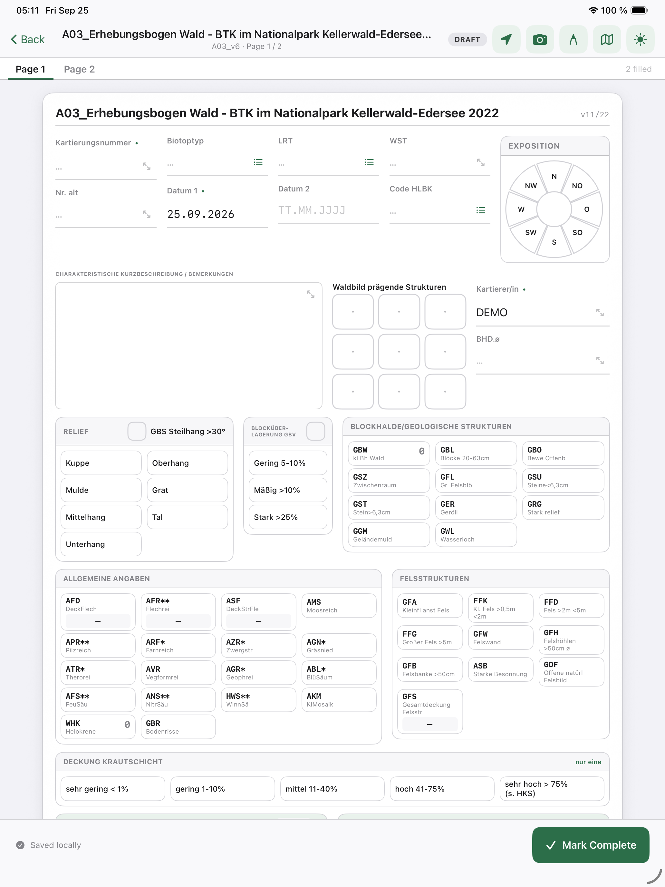
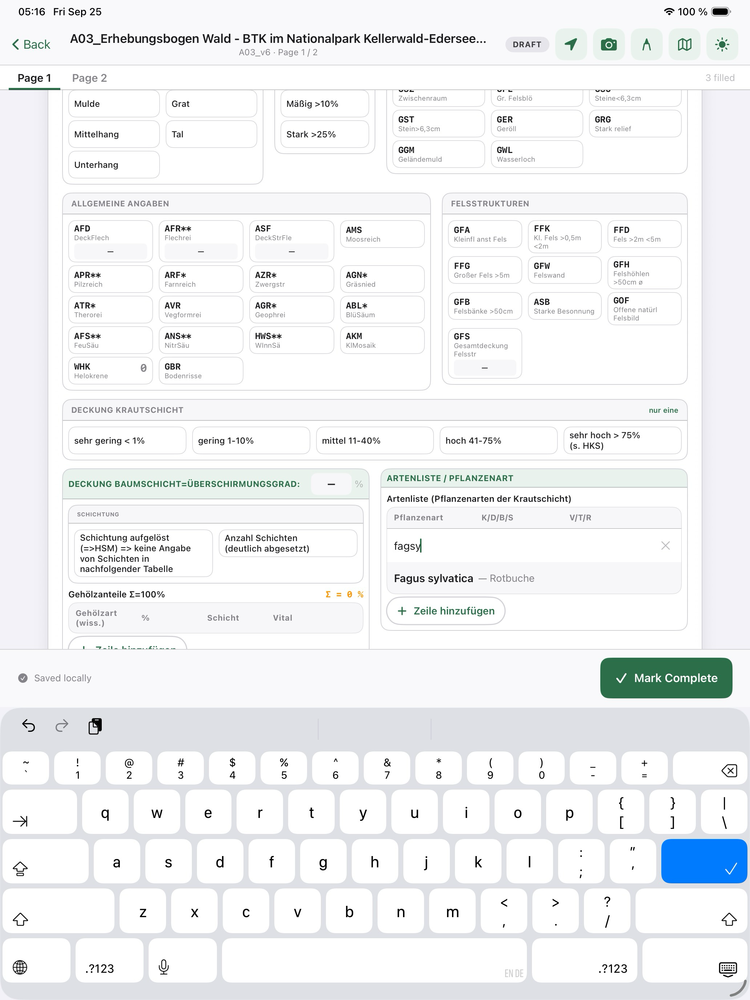

# HLBK Form Digitizer

**Handwritten survey forms to reviewed data, from a scan or straight from the field.**

[Why it is hard](#why-it-is-hard) · [Two routes in](#two-routes-in) · [Evidence](#evidence) · [Design decisions](#design-decisions) · [Field Tablet sync](#field-tablet-sync)

Handwritten ecological survey forms (A03 Kartierbögen) take days to type in at the end of a mapping season. This project cuts that work down to reviewing a draft: a Flask tool reads scanned forms with Claude Vision and matches species names against a taxonomy, and a native iPad app captures the same form directly in the field. A human reviews every result before it is saved.

Built for a one-person ecological survey office in Hesse. Solo project.

> [!NOTE]
> Both implementations (web tool and iPad app) are private. This repository is a case study: design decisions, evidence and screenshots.

## Why it is hard

Handwriting, faint pre-printed grid lines and abbreviated or misspelled Latin species names all defeat naive OCR. A wrong species match that looks plausible is worse than an obvious miss, so the system is built around making doubt visible instead of hiding it.

## Two routes in

- **Paper:** scanned form, image preprocessing, vision extraction, species matching, review in a web workspace, save to SpatiaLite.
- **Field:** iPad entry (Apple Pencil ink, GPS, species autocomplete), local session, authenticated sync into the same web workspace, review, save.

*A03 form entry in the iPad app. Simulator, synthetic survey data.*

## Evidence

On one hand-transcribed page, Claude Vision extraction got 12 of 18 fields correct against 9 of 18 for an OCR + Claude Haiku pipeline. This is a single-page benchmark, not an accuracy rate.

The author estimates that the iPad app cuts total time per survey form (field work plus desk work) by about 70%. This is an estimate, not a measurement.

## Design decisions

| Decision | Why |
|---|---|
| Otsu thresholding, auto-calibrated and clamped to a fixed range | Removes faint pre-printed grid marks while keeping handwriting, which would otherwise confuse the vision model |
| Iterative compression to a token budget (quality first, then dimensions) | Bounds input tokens and therefore cost per form |
| Prompt per form section, confidence per field, multi-page results merged | Long forms extract more reliably in parts, and low-confidence fields can be flagged |
| Two-phase species matching: exact lookup, then RapidFuzz WRatio fallback, tiers at 90 and 70 | Handwriting and abbreviations break exact match. The score means name similarity, not correct identification, so 70-89 is flagged and below 70 needs a manual choice |
| Human review before every save | Extraction output is a draft transcription, never a record |
| Unit-of-work writes into SpatiaLite | A single match failure must not leave a half-written survey record |
| Native SwiftUI + PencilKit instead of a browser app | Apple Pencil support is far better natively |

## Field Tablet sync

Sessions move Draft, Completed, Synced. Completed sessions are posted over authenticated HTTP into the web workspace with `validated: false`, so review still applies. Sessions and cached templates are kept in Core Data for offline entry. An end-to-end offline-to-production round trip has not been verified.

*Species autocomplete: fagsy to Fagus sylvatica (Rotbuche). Simulator, synthetic survey data. The park title shown belongs to the form template, not a captured survey location.*

---

*Built by [Jannis Menzler](https://github.com/jmenzler)*
